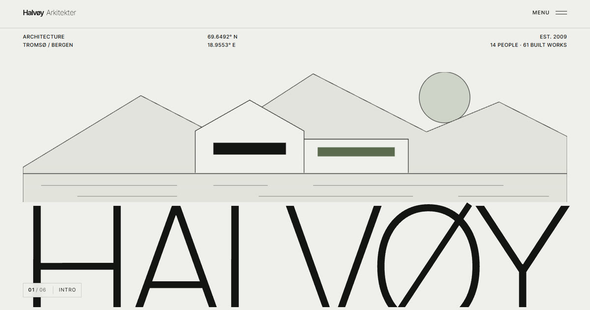

# Studio Halvøy

A portfolio site for a fictional Arctic architecture studio.
Strict Swiss grid: off-white paper, near-black ink, one moss-green accent, thin display type and hairline rules.

**Live site:** https://minty-web.github.io/3/



## What's inside

- **Giant wordmark** that is measured and scaled with JavaScript so its letters always span the page exactly
- **Layered hero illustration** with gentle parallax on scroll
- **Horizontal project gallery**: scroll-snap, drag with the mouse, arrow buttons, keyboard arrows and a progress bar
- **Line-drawing reveal**: every project illustration draws its own strokes the first time it scrolls into view
- **Filterable project index** (residential / cultural / public) with animated rows and a live count
- **Full-screen menu** with staggered links, a focus trap and Escape to close
- A fixed section indicator ("03 / 06 · Index") that follows you down the page
- Responsive, keyboard friendly, respects reduced motion

## Built with

Plain HTML, CSS and JavaScript. No frameworks, no build step.
Font: [Inter Tight](https://fonts.google.com/specimen/Inter+Tight).

```
index.html    page structure, content and SVG drawings
styles.css    grid, typography and animations
script.js     menu, gallery, filters, parallax, line drawing
favicon.svg   logo mark
```

## Run it locally

Open `index.html` in a browser, or serve the folder:

```bash
npx serve .
```

---

Studio Halvøy is a fictional practice and every project shown is imagined. Concept site designed and built by [minty-web](https://github.com/minty-web).
